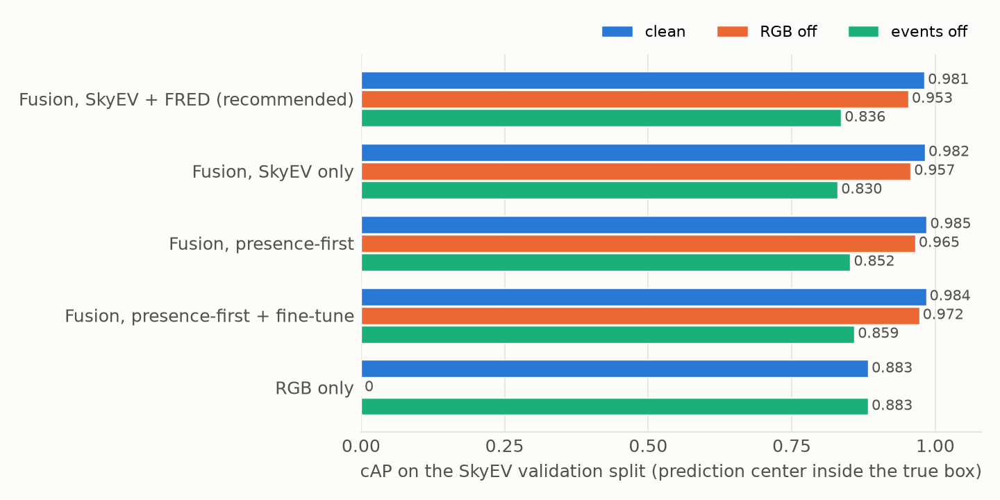

# Event + RGB drone detection with YOLO26

Small-drone detector that reads an RGB frame and an event-camera histogram of the same moment and fuses them inside a
YOLO26n. Built on [Ultralytics](https://github.com/ultralytics/ultralytics) 8.4, trained on
[SkyEV](https://arxiv.org/abs/2607.18747) and [FRED](https://github.com/miccunifi/FRED), deployed as a TensorRT engine on
a Jetson AGX Orin at 1280×736 and 30 fps.

The network is a standard YOLO26n with a two-stem front end (`evrgb/modules.py`): one stem reads the 3 RGB channels,
one reads the 10 event channels, and a learned per-pixel gate mixes the two feature maps before the shared trunk.
Every dataset, augmentation and loss option lives in this repo; Ultralytics supplies the trunk, head, loss and trainer.

## Results

SkyEV validation split, 1280×736, 33 ms event window. **cAP** is average precision where a prediction counts as a hit
when its center lies inside the true box, regardless of box size. For drones of 5–15 px it is the metric that matters:
was the drone found and where. mAP50-95 additionally grades how tightly the box is drawn.



| model | mAP50 | mAP50-95 | cAP clean | cAP RGB off | cAP events off |
|---|---|---|---|---|---|
| **Fusion, trained on SkyEV + FRED** (recommended) | .952 | .571 | .981 | .953 | .836 |
| Fusion, trained on SkyEV only | .954 | **.580** | .982 | .957 | .830 |
| Fusion, presence-first variant ¹ | | .349 ² | .985 | .965 | .852 |
| Fusion, presence-first + event-dropout fine-tune ¹ | | .349 ² | .984 | .972 | .859 |
| Plain 13-channel YOLO26n (no gate) | .930 | .541 | | | |
| RGB only | .835 | .509 | .883 | 0 | .883 |
| Events only | .907 | .472 | | | |

¹ Same recipe, but trained on labels grown to at least 24 px and with the loss weight moved from box regression to
classification (see *Presence-first variant* below).
² Draws 24 px boxes around 8 px drones, so strict-IoU mAP against the original labels is low by design; on the grown
labels it scores .66.

Reading the table: every fusion model finds 98 % of the drones on clean frames, and the differences between them are
within what two training seeds would give. They differ in two things only. Box precision, where the standard recipe
wins and the presence-first variant gives up the box size on purpose. And behaviour when a sensor fails, where the
presence-first fine-tune finds 1–2 more drones per 100. All of them keep .95 or more with the RGB frame missing or
shifted by 8 px, and degrade gracefully without events (.83–.86, close to the RGB-only ceiling of .88). The SkyEV + FRED
model also scores .52 mAP50-95 on the FRED validation split, within one point of a model trained on FRED alone, so one
checkpoint serves both datasets.

## Pretrained checkpoints

The three fusion models trained on SkyEV + FRED are in `best_models/`, about 5 MB each, with the `results.csv`
(training curve) and `args.yaml` (every flag) of their run next to them.

| file | model | use it when |
|---|---|---|
| `eventrgb_dualstem_mixed_zoom1280_yolo26n2.pt` | recommended | you want real box sizes and standard mAP |
| `eventrgb_dualstem_mixed_center1280_yolo26n.pt` | presence-first | only presence and position matter |
| `eventrgb_dualstem_mixed_center_dropevt30_1280_yolo26n.pt` | presence-first + fine-tune | same, and a sensor may fail in deployment |

All take the 13-channel input described below at 1280×736. Load one with `YOLO("best_models/<file>.pt")` after
`import evrgb` (registers the fusion module), fine-tune from it with `--pretrained best_models/<file>.pt`, or export it
as shown under *Export*.

## Install

Python ≥ 3.14, CUDA 13 wheels of PyTorch 2.10 (edit `pyproject.toml` for another CUDA version).

```bash
uv sync
source .venv/bin/activate
```

Put the COCO-pretrained `yolo26n.pt` from the Ultralytics releases in the repo root. Its weights are remapped into both
stems and the trunk at the start of training.

## Data format

One folder per sequence, three subfolders with one file per frame, sorted by name length then name so `event_10`
follows `event_9`. The three lists must have the same length.

```
<root>/
  train/
    <sequence>/
      events/  event_0.npy|npz   uint8 [10, H, W]   5 time bins × 2 polarities, event counts, clipped at 10
      rgbs/    rgb_0.npy|jpg     uint8 [H, W, 3]    RGB, same moment, registered to the event sensor
      labels/  label_0.npy       structured array, fields x y w h (px, top-left origin) and class_id
  val/
    ...
```

The event histogram covers the 33 ms before the RGB exposure ends. Frames without a drone have an empty label array.
`test/make_fake_dataset.py <dir>` writes a tiny random dataset in this layout for smoke tests.

Point a data yaml at the root. The yamls in `conf/` are templates with a placeholder `path:`; set it to your dataset
root. The training commands below use `conf/mixed_data.yaml`, the SkyEV + FRED mix built by
`utils/make_mixed_dataset.py`. For your own data, copy any of them, say to `conf/mydata_local.yaml` (`*_local.yaml` is
ignored by git), and pass it with `--data`.

```yaml
path: /data/my_dataset   # the folder that holds train/ and val/
train: train
val: val
channels: 13             # 3 RGB + 10 event
imgsz: [736, 1280]       # height, width after padding to a multiple of 32
names:
  0: drone
```

## Train the recommended model

One command: 12 epochs from COCO weights on the SkyEV + FRED mix with the full augmentation recipe. `best.pt` is the
epoch with the best mAP50-95. This is the first row of the table.

```bash
python -m train.eventrgb_dualstem_aug --name zoom1280 --data conf/mixed_data.yaml --imgsz 1280 --device 0 \
    --flip 0.5 --photo 0.5 --blur 0 --exposure 0.7 1.4 --shift 2 1 --drop-rgb 0.1 --drop-evt 0.05 \
    --zoom 0.5 1.5 --zoom-out 1.2 --epochs 12
```

### Presence-first variant

For a deployment that only needs to know whether a drone is there and where, not how big it is, three flags change the
objective: `--min-box 24` grows every label to at least 24 px on train and val, `--box 3 --cls 1.5 --dfl 0.5` moves the
loss weight from box regression to classification, and `--select center` picks `best.pt` by cAP. The boxes come out at
a fixed 24 px, so standard mAP no longer applies to this model.

```bash
python -m train.eventrgb_dualstem_aug --name center1280 --data conf/mixed_data.yaml --imgsz 1280 --device 0 \
    --flip 0.5 --photo 0.5 --blur 0 --exposure 0.7 1.4 --shift 2 1 --drop-rgb 0.1 --drop-evt 0.05 \
    --zoom 0.5 1.5 --zoom-out 1.2 --min-box 24 --box 3 --cls 1.5 --dfl 0.5 --select center --epochs 12
```

An optional 4-epoch fine-tune with the event channels hidden in 30 % of the frames teaches the gate to fall back to
RGB when the event stream dies. It gains 1–2 points of cAP under sensor failure and nothing on clean frames.

```bash
python -m train.eventrgb_dualstem_aug --name center_dropevt30_1280 --data conf/mixed_data.yaml --imgsz 1280 --device 0 \
    --pretrained runs/detect/yolo/eventrgb_dualstem_center1280_yolo26n/weights/best.pt \
    --flip 0.5 --photo 0.5 --blur 0 --exposure 0.7 1.4 --shift 2 1 --drop-rgb 0.1 --drop-evt 0.3 \
    --zoom 0.5 1.5 --zoom-out 1.2 --min-box 24 --box 3 --cls 1.5 --dfl 0.5 --select center \
    --epochs 4 --lr0 2e-4 --warmup 0
```

### Output

Runs land in `runs/detect/yolo/eventrgb_dualstem_<name>_yolo26n/` with `results.csv` (`val/cAP(B)` column),
`weights/best.pt` and `weights/last.pt`. One epoch over the SkyEV + FRED mix at 1280×736 takes about 85 min on an RTX 4090.

### What the flags do, and what to change

| flag | meaning | change it when |
|---|---|---|
| `--data` | data yaml | always: point it at your dataset |
| `--imgsz` | long side of the input (640 or 1280) | your frames are a different size; the loader pads to a multiple of 32 |
| `--device`, `--batch` | GPU index, train batch (16 fits a 24 GB card at 1280) | smaller card: `--batch 8` |
| `--epochs` | 12 from COCO, 3–4 for a fine-tune | more data: fewer epochs are enough |
| `--flip 0.5` | horizontal flip | keep |
| `--photo 0.5 --blur 0 --exposure 0.7 1.4` | RGB brightness jitter on half the frames | your RGB exposure varies more: widen the range |
| `--shift 2 1` | random RGB-only shift in px (events stay put) | your cameras are well registered: lower; poorly: raise, costs clean accuracy |
| `--zoom 0.5 1.5 --zoom-out 1.2` | random zoom in up to 1.5× or out to 1.2× on half the frames | drone sizes in your data differ from training: this is the main size augmentation |
| `--drop-rgb 0.1 --drop-evt 0.05` | zero a whole modality for that fraction of frames | one sensor is unreliable in deployment: raise its dropout (the fine-tune uses 0.3 for events) |
| `--min-box 24` | grow every label to at least 24 px per side, train and val | presence-first variant only |
| `--box 3 --cls 1.5 --dfl 0.5` | loss gains (Ultralytics defaults 7.5 / 0.5 / 1.5) | presence-first variant only; otherwise leave at defaults |
| `--select center` | pick `best.pt` by cAP instead of mAP50-95 | presence-first variant only |
| `--pretrained` | COCO `yolo26n.pt` or any checkpoint of this repo | fine-tuning |
| `--lr0 2e-4 --warmup 0` | fixed AdamW learning rate, no warmup | fine-tuning only; omit for training from COCO |
| `--modality rgb\|event` | single-modality reference model (plain YOLO26n) | to measure what one sensor alone gives |
| `--baseline` | plain 13-channel YOLO26n, no gate | ablation |

Other adaptations:

- **Different event representation.** Set `channels` in the data yaml to `3 + bins` and the first argument of
  `DualStemFuse` in `conf/yolo26_evrgb_dualstem.yaml` to the same number. Any per-frame uint8 or float histogram works.
- **More classes.** Add them to `names` in the data yaml and set `nc` in the model yaml.
- **Other model size.** The model yaml has YOLO26 n/s/m/l/x scales; the stems scale with the trunk. Use the matching
  COCO checkpoint as `--pretrained`.
- **Video memory.** A ConvLSTM in the event stem (`--mem lstm --clip-len 4`) is implemented and tested but gave no gain
  on SkyEV; a two-backbone variant (`--tower`) likewise.

## Evaluate

Scores a checkpoint under controlled perturbations: sensors zeroed, RGB darkened, brightened, noised, shifted by
2/4/8 px or replaced by the previous frame, event counts halved, doubled, noised, thinned or time-shifted by 1–5 bins.
Prints mAP50-95 and cAP per condition. Several checkpoints make one table.

```bash
python test/robustness_eval.py runs/detect/yolo/<run>/weights/best.pt --data conf/mixed_data.yaml --imgsz 1280 --device 0
python test/robustness_eval.py <best.pt> --data ... --conditions clean rgb_zero evt_zero          # subset
python test/robustness_eval.py <best.pt> --data ... --min-box 24                                 # grown labels, like training
```

`test/size_eval.py` splits the score by drone size, `test/tracker_eval.py` runs ByteTrack over the predictions.

## Export

Export a pretrained checkpoint, or your own `runs/detect/yolo/<run>/weights/best.pt`, to ONNX. The height and
width are the padded input size; the `.onnx` file is written next to the `.pt`.

```bash
M=best_models/eventrgb_dualstem_mixed_zoom1280_yolo26n2
python onnx/export_evrgb.py $M.pt 736 1280
python onnx/test_onnx_evrgb.py $M.onnx <event.npz> <rgb.jpg> $M.pt   # ONNX vs PyTorch on one frame of your data
```

The ONNX model takes one tensor `[1, 13, 736, 1280]` (RGB scaled to 0–1, raw event counts, bottom-padded from 720 to
736 rows) and returns `[1, max_det, 6]` = `x1 y1 x2 y2 score class`; YOLO26 is end-to-end, so no NMS is needed.

For a Jetson, build the TensorRT engine on the device itself:

```bash
trtexec --onnx=eventrgb_dualstem_mixed_zoom1280_yolo26n2.onnx --fp16 --saveEngine=drone_1280x736_fp16.engine
```

On an AGX Orin the fp16 engine runs in about 7 ms per frame at 1280×736; int8 saves one more millisecond and is not
worth the calibration. The same steps apply to the presence-first checkpoints, which have the same architecture and
speed.

## Repository layout

| folder | contents |
|---|---|
| `evrgb/` | the two-stem gated fusion module, its config loader, COCO weight remapping, optional ConvLSTM |
| `conf/` | model yamls (dual stem, P2 head, two tower, plain) and data yamls |
| `datasets/` | the sequence loader and the augmentation chain (flip, photometric, shift, zoom, min-box, pad) |
| `engine/` | Ultralytics trainer and validator subclasses (modality dropout, cAP, `--select`) |
| `train/` | entry points; `eventrgb_dualstem_aug.py` is the one to use |
| `test/` | unit tests on the fake dataset, robustness, size and tracker evaluation |
| `onnx/` | export and ONNX check |
| `utils/` | mixed-dataset builder, tensor formatting for inference |
| `docs/` | the chart above and its script |
| `MODELS.md` | registry of every trained run with scores and notes |

Each test runs on CPU against the fake dataset, for example
`PYTHONPATH=. python test/test_center_ap.py <fake>/fake_data.yaml`.
